# Vẽ mố, trụ và bóc tách khối lượng bằng AI agent — hướng dẫn sử dụng

Tài liệu dành cho kỹ sư dùng Cadview. Bạn sẽ dựng hồ sơ mố và trụ cầu, sửa
thông số, lập bảng bóc tách khối lượng (BTKL) phần kết cấu và xuất ra Excel —
tất cả bằng câu lệnh tiếng Việt gõ cho **CAD Agent**.

Tài liệu có ba phần:

1. Vẽ mố và trụ (bước 1–7)
2. Bóc tách khối lượng (bước 8–13)
3. Lỗi thường gặp và hỏi đáp

> Mọi bản vẽ và bảng khối lượng sinh ra đều là **bản nháp**, chưa phát hành
> thi công. Các giả định đang dùng và các câu hỏi chờ chủ dự án chốt nằm ở
> [Các điểm chờ chốt](./CAC-DIEM-CHO-CHOT.md).

---

## Phần 1. Vẽ mố và trụ

### Bước 1 — Mở bản vẽ mới

Màn hình đầu tiên là **"Chọn tệp CAD để mở"**. Bấm **Bản vẽ mới** để có một
bản vẽ trống. Muốn làm trên bản vẽ có sẵn thì thả tệp DWG/DXF vào khung,
hoặc bấm **chọn tệp**.

### Bước 2 — Mở CAD Agent

Có hai cách:

- Trên thẻ **Trang chính** của ribbon, bấm nút **CAD Agent** (biểu tượng bong
  bóng chat) ở đầu bên phải. Nếu cửa sổ hẹp (dưới khoảng 1600 px), nút này
  bị gom vào menu **"…"** ở cuối ribbon.
- Hoặc gõ lệnh **`agent`** vào dòng lệnh. Gõ lại lần nữa thì đóng bảng.

Bảng **Trợ lý** (thẻ "Trợ lý", nhãn dọc "CAD Agent") mở ở cạnh trái màn hình. Gõ câu lệnh vào ô
**"Mô tả hình cần vẽ…"** rồi nhấn **Enter**, hoặc bấm nút mũi tên **Gửi**.
Trong lúc agent làm việc, nút đổi thành **Dừng** và hiện "Đang xử lý…".

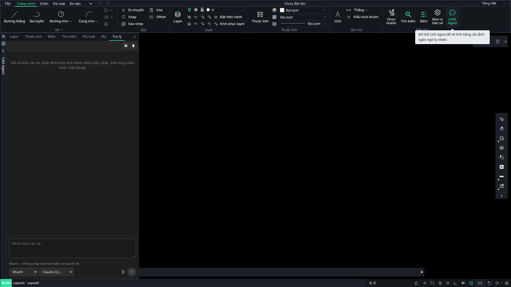

### Bước 3 — Chọn chế độ

Ô **Chế độ** nằm ở góc dưới bên trái ô nhập. Hãy chọn **Nhanh**: agent vẽ
xong không chụp màn hình kiểm lại, đủ cho các việc trong tài liệu này.
Ô **Mô hình** bên cạnh để mặc định **Claude CLI (server)**: máy chủ chạy
agent bằng Claude CLI.

- **Suy luận sâu**: agent vẽ xong thì chụp màn hình và tự kiểm (tối đa 5
  vòng). Chậm hơn và cần mô hình đọc được ảnh.
- Chọn **Gọn** hiện **không có tác dụng** (lỗi đã biết). Dùng **Nhanh**.

Nếu dưới ô nhập có thông báo "Lưu thiết lập trước khi gửi tin nhắn" hoặc
"Cấu hình API key…", bấm biểu tượng **Thiết lập** trên đầu bảng. Máy chủ mặc
định là "Máy chủ của hệ thống (khuyến nghị)" và không cần API key.

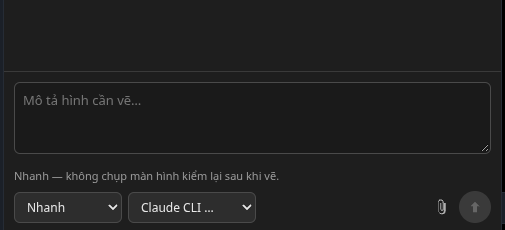

### Bước 4 — Dựng hồ sơ mố M1

Gõ:

> Dựng bộ hồ sơ mố M1 theo mẫu BTC mo_2.

- Agent gọi **`tao_ho_so_mo`**. Trong bảng chat hiện dòng
  `công cụ: tao_ho_so_mo`.
- Bản vẽ có **6 tờ A3 tỷ lệ 1:100**: SUB-010, SUB-020, SUB-070, SUB-080,
  SUB-090, SUB-100. Thông số mặc định lấy theo bản gốc, gồm:
  - bệ 7700 × 6000 × 2000 mm;
  - 4 cọc D1200;
  - dốc ngang 2 %;
  - cao độ đáy bệ 228,837 m.
- Muốn đổi thông số ngay khi dựng thì nói luôn, ví dụ "…bệ cao 2500 mm".
  Chiều dài tính bằng mm, cao độ bằng m, dốc bằng %.
- Mỗi tên mố chỉ có một hồ sơ: dựng M1 lần thứ hai sẽ bị từ chối.

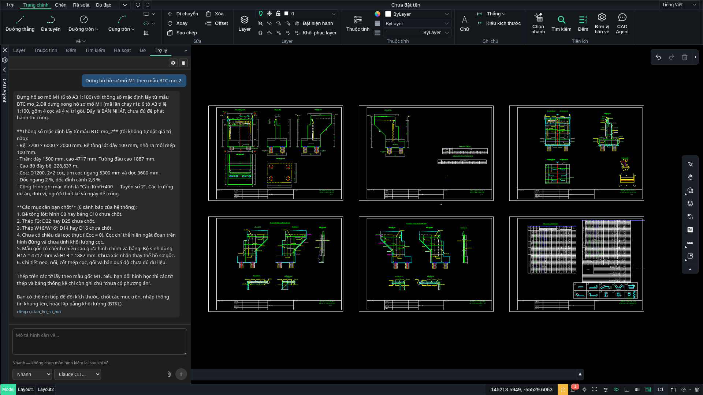

### Bước 5 — Sửa thông số mố

Gõ:

> Đổi chiều cao bệ mố M1 thành 2500 mm.

- Agent gọi **`sua_ho_so_mo`** và chỉ truyền phần thay đổi (`hBe = 2500`).
- **Co giãn được:** `hBe`, `hLot`, `lBe`, `muiBe`, `tThan`, `hThan`, `hDau`,
  `lCanh`, `D`, và `bBe` nếu đổi kèm `bThan = bBe` và
  `aCocNgang = bBe − 2·D`. Hình, kích thước, thẻ cao độ và bảng SUB-020 đổi
  theo.
- **Không đổi hình:** `caoDoDayBe`, `lCoc`, tên mố, công trình, khung tên.
- **Bị từ chối, hồ sơ giữ nguyên:** đổi số hoặc bố trí cọc, `tCanh`, dốc,
  `bThan` khác `bBe`, hoặc hình bị tràn khỏi khung A3.
- Hồ sơ đã bị sửa tay thì `sua_ho_so_mo` cũng từ chối dựng lại.
- Khi hình học khác M1, các tờ thép SUB-070/080/090 ghi **"CHƯA CÓ PHƯƠNG ÁN
  THÉP CHO HÌNH HỌC NÀY"** và SUB-100 ghi **"BẢNG THỐNG KÊ THÉP VÀ KHỐI LƯỢNG
  CHƯA ÁP DỤNG"**. Agent báo cao độ mới (ví dụ đỉnh bệ 231,337 m, đáy bệ giữ
  228,837 m) và nhắc lại các mục còn mở.
- Trên hình, kích thước chiều cao bệ ghi bằng ký hiệu **HB** (không ghi số);
  hình bệ cao lên theo số mới.

Để làm theo các ví dụ ở Phần 2, đưa bệ về như cũ:

> Đổi chiều cao bệ mố M1 về 2000 mm.

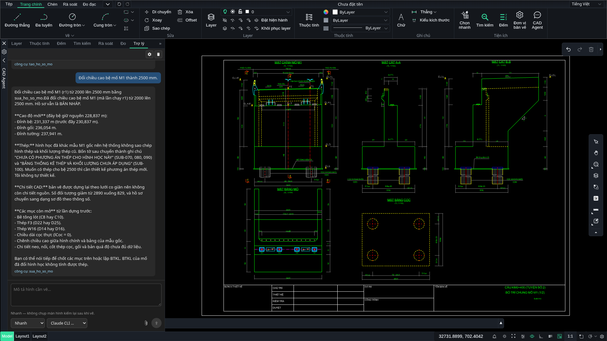

### Bước 6 — Dựng trụ T1

Trụ dựng bằng cách ghép **`tru_cau_hoan_chinh`**: một lệnh dựng cả mặt chính
(`tru_mat_chinh`) và mặt bên (`tru_mat_ben`) với cùng một bộ số. Gõ:

> Dựng trụ cầu bằng cách ghép tru_cau_hoan_chinh, đặt tim trụ ở x = 0,
> đáy bê tông lót ở y = -60000.

- Agent thường đọc hướng dẫn trụ trước (`công cụ: doc_huong_dan`), rồi gọi
  **`ghep_bo_phan`** với mã ghép `tru_cau_hoan_chinh`.
- Kết quả là hai lần chạy: `r2` mặt chính (tim x = 0) và `r3` mặt bên (tim
  x = 16000). Agent nói rõ đây là bố cục sơ bộ, liệt kê thông số mặc định và
  các điểm cần kiểm theo TCVN 11823.
- **Thông số chung của cách ghép:**
  - `x`, `y`: tim trụ và đáy bê tông lót;
  - `kcHinh`: khoảng cách giữa hai hình chiếu, mặc định 16000;
  - `soCot`: 0 là thân tường đặc, 1–6 là số cột;
  - `hThan`, `bXaMu`, `bBe`, `lBe`, `D`.
- Các tham số khác của template trụ (`lCoc`, `soCocNgang`, `soGoi`…) cũng
  truyền được.
- Đặt trụ ở `y = -60000` để không đè lên các tờ hồ sơ mố.
- Template trụ là **bố cục sơ bộ**, chưa đối chiếu bản vẽ của văn phòng.
- Có thể dựng riêng một hình chiếu bằng **`chay_template`** với mã
  `tru_mat_chinh` hoặc `tru_mat_ben`. Nhưng để BTKL đếm đúng một trụ, nên
  dùng cách ghép.

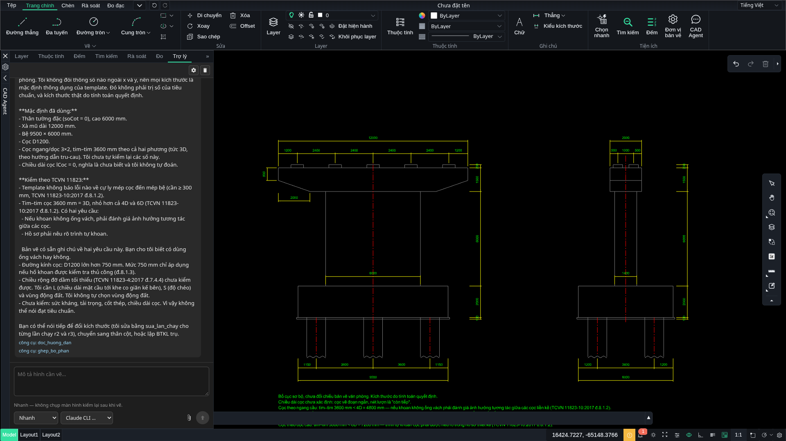

### Bước 7 — Sửa thông số trụ

Trụ là hai **lần chạy** template (mặt chính và mặt bên). Muốn BTKL nhận được
thông số mới thì phải **dựng lại cả hai lần chạy** theo template. Hãy nói rõ
"dựng lại toàn bộ":

> Dựng lại toàn bộ trụ T1 theo template, cả mặt chính và mặt bên, với chiều
> dài cọc lCoc = 25000 mm.

- Agent gọi **`sua_lan_chay`** hai lần (`r2` rồi `r3`) với
  `dung_lai_toan_bo = true`. Nếu agent chưa biết mã lần chạy, nó gọi
  `mo_ta_ban_ve` trước để lấy.
- Cọc trên cả hai hình kéo dài 25 m.
- Nếu bạn chỉ nói "đổi…", agent sẽ sửa thẳng trên nét CAD
  (`execute_cad_script`). Hình đổi, nhưng thông số lưu trong lần chạy không
  đổi, nên **BTKL không thấy thay đổi**.
- Nếu chỉ dựng lại một hình, hai hình lệch số nhau và BTKL sẽ đếm thành hai
  trụ.

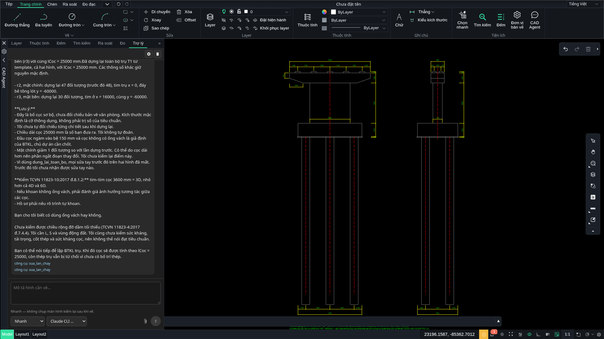

---

## Phần 2. Bóc tách khối lượng

BTKL đọc mọi **mố** (hồ sơ `ho_so_mo_m1`) và **trụ** (`tru_mat_chinh` /
`tru_mat_ben`) trong bản vẽ, rồi tính khối lượng **từ chính thông số** của
chúng:

- bê tông theo cấu kiện;
- bê tông lót;
- cọc khoan nhồi, khi đã có `lCoc`;
- ván khuôn;
- cốt thép.

Mỗi dòng ghi **diễn giải công thức** bằng trị số thật. Với mố M1 gốc, mỗi
dòng được so với bảng khối lượng SUB-100 của bản vẽ gốc và gắn cờ khi lệch.
Dòng nào không tính được thì bị **từ chối, có ghi lý do**.

### Bước 8 — Lập BTKL: `tao_btkl`

Gõ:

> Lập bảng bóc tách khối lượng kết cấu cho các mố, trụ trong bản vẽ.

- Agent gọi **`tao_btkl`**. Các tờ A3 BTKL đặt cách mép phải bản vẽ 10 m,
  đáy tờ ngang đáy bản vẽ. Với M1 và T1 có hai tờ: BTKL-01 và BTKL-02 (TIẾP
  THEO).
- Muốn đặt ở chỗ khác thì nói vị trí, ví dụ "…đặt bảng ở x = 200000, y = 0".
- Agent trả **mã lần chạy** của BTKL (ví dụ `r4`) và các tổng chính.
- Mỗi bản vẽ chỉ có **một** BTKL; gọi lập lần nữa sẽ bị từ chối.

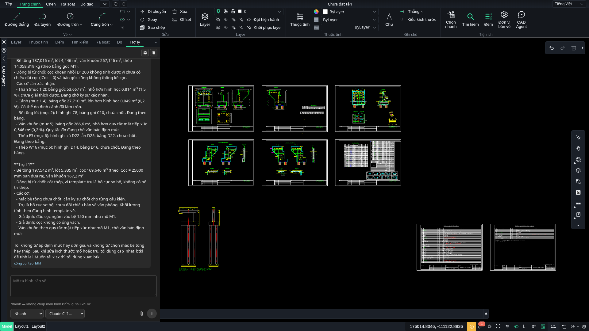

### Bước 9 — Đọc tờ A3 BTKL

Phóng to tờ BTKL-01.

- **Tiêu đề** "BẢNG TỔNG HỢP KHỐI LƯỢNG KẾT CẤU". Dòng dưới ghi công trình
  và các đối tượng.
- **Bảng 5 cột:** STT · Hạng mục · Đơn vị · Khối lượng · Diễn giải công thức.
  Mỗi đối tượng bắt đầu bằng dòng tên viết hoa (MỐ M1, TRỤ T1).
- **Màu chữ:**
  - xanh lá: đầu mục (bê tông, lót, cọc, ván khuôn, thép);
  - trắng: số liệu và diễn giải;
  - **đỏ**: cờ (bắt đầu bằng `[!]`) và lý do từ chối ("Không tính: …");
  - xám: các dòng chỉ để tham khảo, không cộng tổng (vai kê, vút; mặt đầu và
    đáy xà mũ, đá kê).
- **Số liệu:** làm tròn 3 chữ số thập phân, ví dụ `14 058,319`. Dòng không
  tính ghi `—`.
- **Khung tên A3:**
  - số hiệu `BTKL-01`, `BTKL-02`…, tờ số `k/N`;
  - dòng "BẢN NHÁP — CHƯA PHÁT HÀNH THI CÔNG";
  - dự án, công trình, đơn vị, người ký lấy từ hồ sơ mố đầu tiên.
- **Bảng dài:** sang tờ kế bên phải, lặp lại hàng tiêu đề, tiêu đề ghi
  "(TIẾP THEO)".

Kết quả ở thông số mặc định (bệ M1 cao 2000 mm, trụ T1 có `lCoc = 25000`):

| Đối tượng | Bê tông                                  | Ván khuôn      | Cọc                             | Thép                                 |
| --------- | ---------------------------------------- | -------------- | ------------------------------- | ------------------------------------ |
| Mố M1     | C30 **187,016 m³**; lót C10 4,446 m³     | **267,146 m²** | từ chối (`lCoc = 0`)            | **14 058,319 kg** (69 số hiệu)       |
| Trụ T1    | 197,542 m³ (mác chưa chốt); lót 5,335 m³ | 167,200 m²     | 169,646 m³ (6 cọc D1200 × 25 m) | từ chối (trụ chưa có phương án thép) |

So với bảng SUB-100 bản gốc của M1:

- tổng bê tông C30 186,253 (+0,763);
- tường thân 53,667 (+0,814, có cờ);
- tường cánh 27,710 (−0,049, có cờ);
- ván khuôn 266,600 (+0,546, có cờ);
- bệ, lót và thép khớp.

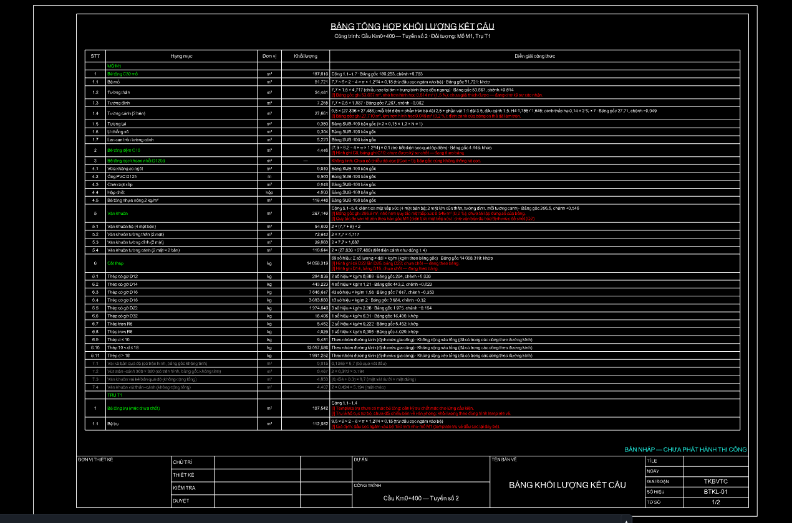

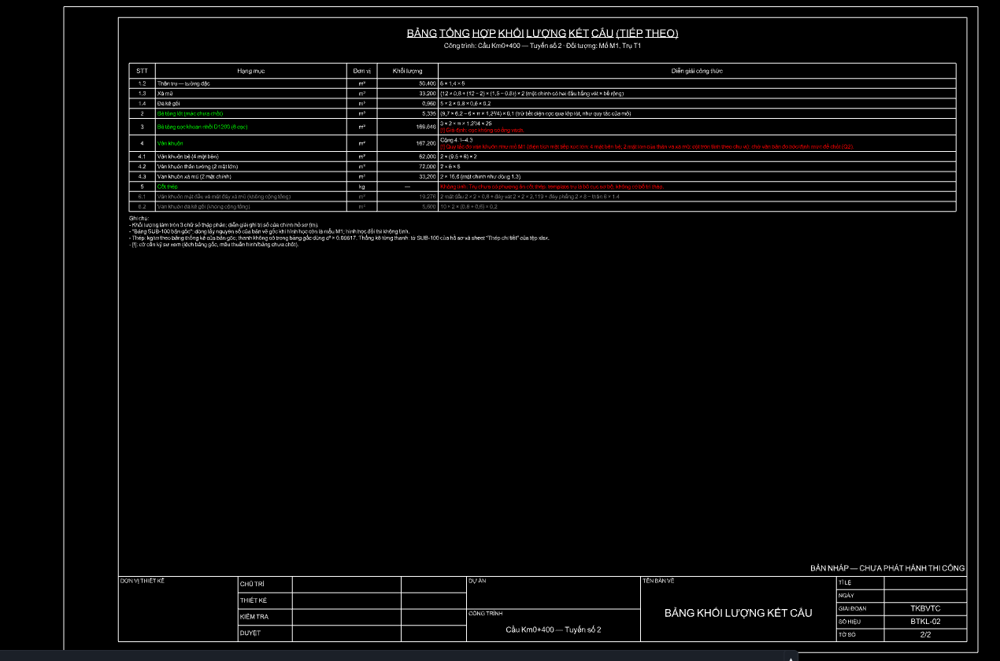

### Bước 10 — Cập nhật sau khi sửa kích thước: `cap_nhat_btkl`

Bảng **không tự đổi** khi bạn sửa mố hoặc trụ. Ví dụ gõ hai câu:

> Đổi chiều cao bệ mố M1 thành 2500 mm.

> Cập nhật lại bảng khối lượng.

- Agent gọi `sua_ho_so_mo`, rồi **`cap_nhat_btkl`** với mã BTKL. Tờ được dựng
  lại tại chỗ (cùng mã, cùng vị trí). Kết quả có cả tổng **trước** và
  **sau**.
- Khi đã có BTKL, agent thường tự gọi `cap_nhat_btkl` ngay sau câu sửa đầu
  tiên. Câu thứ hai lúc đó chỉ được trả lời "BTKL đã khớp bản vẽ hiện tại",
  không sửa gì thêm.
- Ván khuôn mố tính lại theo bệ mới (280,846 m² khi bệ cao 2500 mm).
- Bệ M1 thành 114,821 m³.
- **Thép mố bị từ chối**, vì hình học không còn là M1 gốc. Tường tai, ụ chống
  xô, lan can và vật tư cũng bị từ chối. Do đó tổng bê tông C30 ghi "Thiếu
  tường tai, ụ chống xô, lan can trên tường cánh."
- Không có gì thay đổi thì agent báo "đã khớp bản vẽ" và không sửa gì.
- Muốn bỏ lần cập nhật: dùng **Undo**.

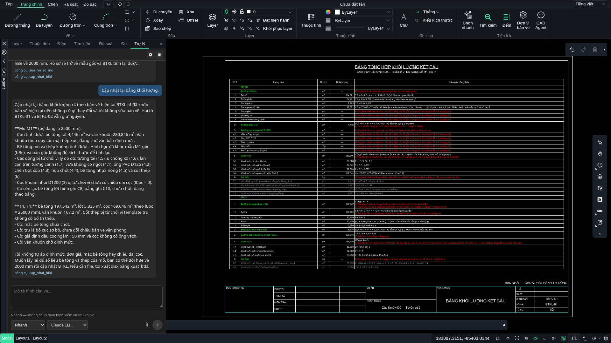

### Bước 11 — Xuất Excel: `xuat_btkl`

Gõ:

> Xuất bảng khối lượng ra Excel.

- Agent gọi **`xuat_btkl`** và trình duyệt tải về một tệp, ví dụ
  `btkl-Cau-Km0-400-Tuyen-so-2.xlsx` (tên lấy theo công trình).
- Nếu bản vẽ không có mố nào để lấy tên công trình, tệp tên là
  `btkl-ket-cau.xlsx`.
- Có hai định dạng: **`xlsx`** (mặc định) và **`json`** ("Xuất BTKL dạng
  json").
- **Không có xuất PDF.** Cần bản in thì mở xlsx trong Excel/LibreOffice rồi
  in ra PDF, hoặc in tờ A3 BTKL trong bản vẽ.
- Nếu xuất theo mã BTKL mà bản vẽ đã đổi từ lúc lập, agent cảnh báo. Khi đó
  chạy `cap_nhat_btkl` trước rồi xuất lại.

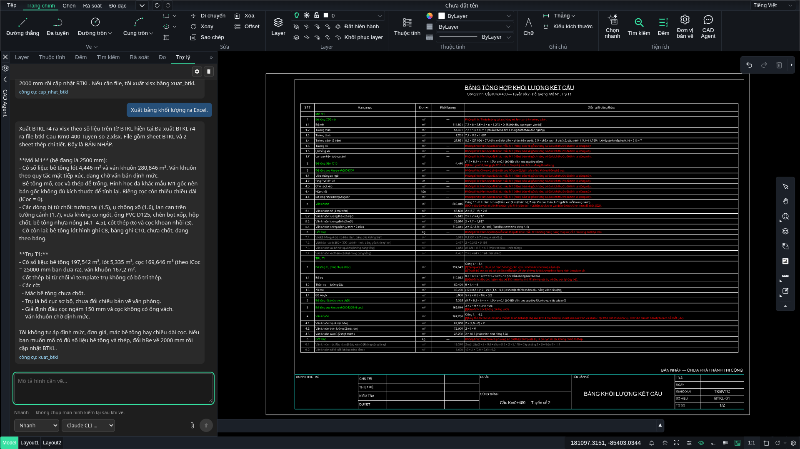

### Bước 12 — Đọc sheet BTKL trong tệp xlsx

- Ở trên cùng là tiêu đề, công trình, đối tượng và ngày lập; tiếp theo là
  hàng tiêu đề 5 cột. Hàng tiêu đề được cố định khi cuộn và lặp lại khi in;
  trang in khổ ngang.
- Dòng tổng và đầu mục in đậm. Dòng tham khảo in nghiêng màu xám.
- Cột **Diễn giải công thức** gồm nhiều phần, ngăn nhau bằng dấu `·`:
  - công thức;
  - so với bảng gốc, ví dụ "Bảng gốc 91,721: khớp" hoặc "Bảng gốc 53,667,
    chênh +0,814";
  - cờ, bắt đầu bằng `⚑`;
  - với dòng bị từ chối: "Không tính: …" kèm lý do.

Ảnh dưới là tệp xuất ở bước 11 (bệ đang cao 2500 mm) mở trong LibreOffice
Calc, nên nhiều dòng của mố ghi "Không tính: …".

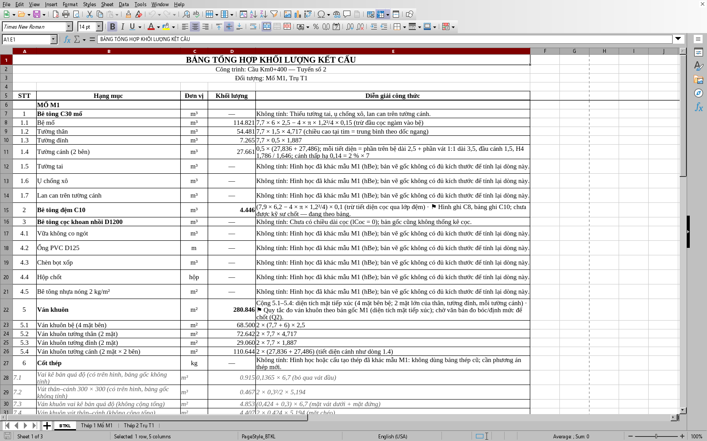

### Bước 13 — Đọc sheet thép chi tiết

- Có một bảng thép cho mỗi đối tượng. Nếu chỉ có một đối tượng, sheet tên
  là `Thép chi tiết`; nếu có nhiều, các sheet tên là `Thép 1 Mố M1`,
  `Thép 2 Trụ T1`…
- **Các cột:** STT, Số hiệu, Đường kính (mm), Loại thép, Số lượng (thanh),
  Dài 1 thanh (mm), Tổng dài (m), kg/m, Khối lượng (kg), Cấu kiện, Ghi chú.
- **Công thức Excel:** "Tổng dài" và "Khối lượng" tính bằng công thức, dòng
  **Tổng cộng** dùng `SUM`. Sửa số lượng hay chiều dài thì Excel tự tính lại.
- Đối tượng không có thép (trụ, hoặc mố đã đổi hình học) chỉ có một dòng
  "Không có bảng thép: …" kèm lý do.

Dấu thập phân hiển thị theo cài đặt vùng của máy mở tệp: tiếng Việt hiện
`14.058,319`, tiếng Anh hiện `14,058.319`. Giá trị lưu bên trong như nhau.

Ảnh dưới chụp sau khi đưa bệ về 2000 mm, cập nhật BTKL và xuất lại
(`sua_ho_so_mo` → `cap_nhat_btkl` → `xuat_btkl`). Ô I4 đang chọn, thanh
công thức hiện `=G4*H4`; cột Ghi chú có cờ `⚑` của F3.

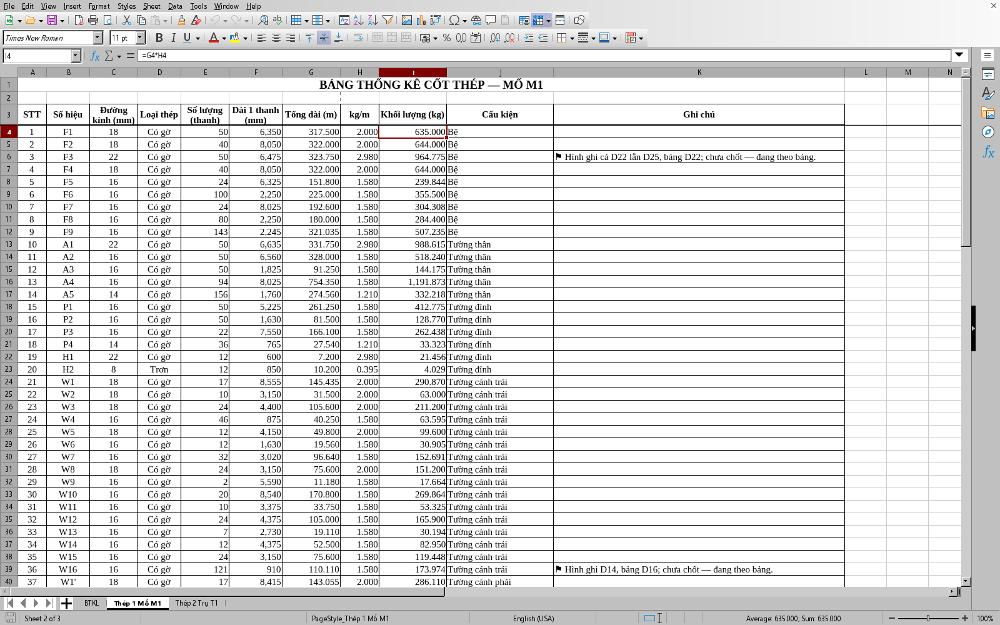

---

## Phần 3. Lỗi thường gặp và hỏi đáp

### Lỗi thường gặp

| Hiện tượng                                                                 | Nguyên nhân                                                                                                                           | Cách xử lý                                                                       |
| -------------------------------------------------------------------------- | ------------------------------------------------------------------------------------------------------------------------------------- | -------------------------------------------------------------------------------- |
| Không thấy nút **CAD Agent**                                               | Cửa sổ hẹp, nút bị gom vào menu "…"                                                                                                   | Mở menu "…" ở cuối ribbon, hoặc gõ lệnh `agent`                                  |
| Không gửi được tin nhắn, có dòng "Lưu thiết lập…" hoặc "Cấu hình API key…" | Thiết lập chưa lưu                                                                                                                    | Bấm **Thiết lập**, chọn "Máy chủ của hệ thống (khuyến nghị)", lưu                |
| Chọn chế độ **Gọn** nhưng không đổi                                        | Lỗi đã biết của ô chế độ                                                                                                              | Dùng **Nhanh**                                                                   |
| `tao_ho_so_mo` báo đã có M1                                                | Mỗi tên mố chỉ có một hồ sơ                                                                                                           | Sửa bằng `sua_ho_so_mo`, hoặc dựng mố khác tên (M2)                              |
| `sua_ho_so_mo` từ chối khi đổi số cọc, `tCanh`, dốc, `bThan ≠ bBe`         | Bản gốc không vẽ được bố trí đó                                                                                                       | Giữ bố trí 2 × 2 cọc sát mép bệ; bố trí khác cần hồ sơ mới                       |
| `sua_ho_so_mo` từ chối vì có sửa tay                                       | Hồ sơ đã bị sửa trực tiếp trên nét                                                                                                    | Sửa tiếp bằng sửa trực tiếp; BTKL vẫn theo thông số đã lưu                       |
| `ghep_bo_phan` báo thiếu template trụ                                      | Thư viện trên máy chủ chưa có `tru_mat_chinh` / `tru_mat_ben`                                                                         | Báo quản trị nạp template trụ                                                    |
| Sửa trụ xong, `cap_nhat_btkl` báo "đã khớp bản vẽ"                         | Agent sửa thẳng trên nét, thông số lần chạy không đổi                                                                                 | Yêu cầu "dựng lại toàn bộ trụ … theo template, cả mặt chính và mặt bên" (bước 7) |
| BTKL đếm **hai trụ** cho một trụ                                           | Mới dựng lại một hình (mặt chính hoặc mặt bên)                                                                                        | Dựng lại cả hai lần chạy với cùng thông số rồi cập nhật                          |
| `tao_btkl` báo đã có BTKL                                                  | Mỗi bản vẽ một BTKL                                                                                                                   | Dùng `cap_nhat_btkl`                                                             |
| `tao_btkl` báo chưa có gì để bóc                                           | Bản vẽ chưa có mố/trụ dựng bằng template                                                                                              | Làm Phần 1 trước                                                                 |
| Dòng thép mố ghi "Không tính"                                              | Hình học khác M1 gốc (mọi kích thước trừ `lCoc`, `caoDoDayBe`), hoặc chọn `thepF3 = D25` / `thepW16 = D14`, hoặc hồ sơ `thep = khong` | Cần phương án thép mới; BTKL không kéo giãn thép cũ                              |
| Dòng cọc ghi "Chưa có chiều dài cọc (lCoc = 0)"                            | Chưa nhập chiều dài cọc                                                                                                               | Nhập `lCoc` (mm) cho mố hoặc trụ, rồi `cap_nhat_btkl`                            |
| Dòng thép trụ luôn "Không tính"                                            | Template trụ không có bố trí thép                                                                                                     | Chờ phương án thép trụ                                                           |

Ví dụ một lần bị từ chối:

> Đổi số cọc mố M1 thành 3 cọc theo ngang cầu.

Agent từ chối, không gọi công cụ nào và hồ sơ giữ nguyên. Lý do: hồ sơ M1
dựng theo bộ sinh 0.3.0, chỉ co giãn được `hBe`, `hLot`, `lBe`, `muiBe`,
`tThan`, `hThan`, `hDau`, `lCanh`, `D`, `bBe`; mọi thay đổi số hoặc bố trí
cọc bị từ chối. Agent gợi ý các hướng khác (đổi thông số cho phép, dựng mặt
chính mố riêng bằng `mo_mat_chinh` với 3 cọc, hoặc sửa tay).

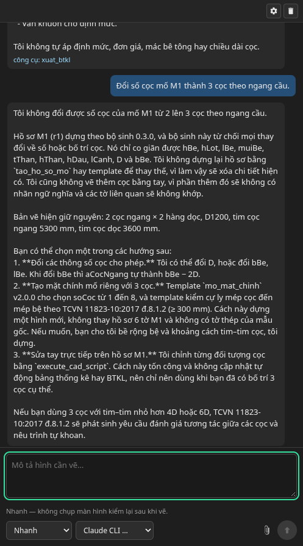

### Hỏi đáp

**Sửa kích thước xong, bảng khối lượng có tự đổi không?**
Không. Phải yêu cầu "cập nhật lại bảng khối lượng" (`cap_nhat_btkl`).

**Tôi sửa tay một ô trên tờ BTKL, cập nhật có giữ không?**
Không. Tờ BTKL là kết quả tính, và cập nhật dựng lại toàn bộ tờ. Muốn đổi số
liệu thì sửa thông số mố/trụ, hoặc sửa trong tệp xlsx sau khi xuất.

**Vì sao tường thân M1 khác bảng gốc 0,814 m³?**
Chưa giải thích được. BTKL tính theo hình học thật, gắn cờ và chờ kỹ sư xác
nhận (điểm chờ chốt 6).

**Vai kê bản quá độ và vút có được tính không?**
Có ghi trên tờ, ở mục 7 của mố, nhưng không cộng vào tổng vì bảng gốc không
tính hai phần này.

**Thân cột của trụ tính tròn hay vuông?**
Tròn, đường kính `dCot`. Đây là giả định tạm, có cờ `gia_dinh`. Cũng là giả
định: đầu cọc ngàm 150 mm vào bệ, cọc không có ống vách.

**Có xuất PDF được không?**
Không có công cụ xuất PDF cho BTKL. In từ xlsx hoặc in tờ A3 trong bản vẽ.
(Hồ sơ mố thì có xuất PDF 6 tờ: "Xuất PDF hồ sơ M1 bản nháp", công cụ
`xuat_ho_so_mo`.)

**Có thành tiền, đơn giá không?**
Chưa. BTKL chỉ tính khối lượng (điểm chờ chốt 2).

**Khối lượng phần tuyến (đường) thì sao?**
Chưa làm (điểm chờ chốt 8).

**Cờ `[!]` / `⚑` nghĩa là gì?**
Đó là dòng cần kỹ sư xem: lệch bảng gốc, mâu thuẫn hình/bảng chưa chốt, giả
định tạm, hoặc quy tắc đo chờ văn bản.

Danh sách đầy đủ các giả định và câu hỏi mở:
[Các điểm chờ chốt](./CAC-DIEM-CHO-CHOT.md).
